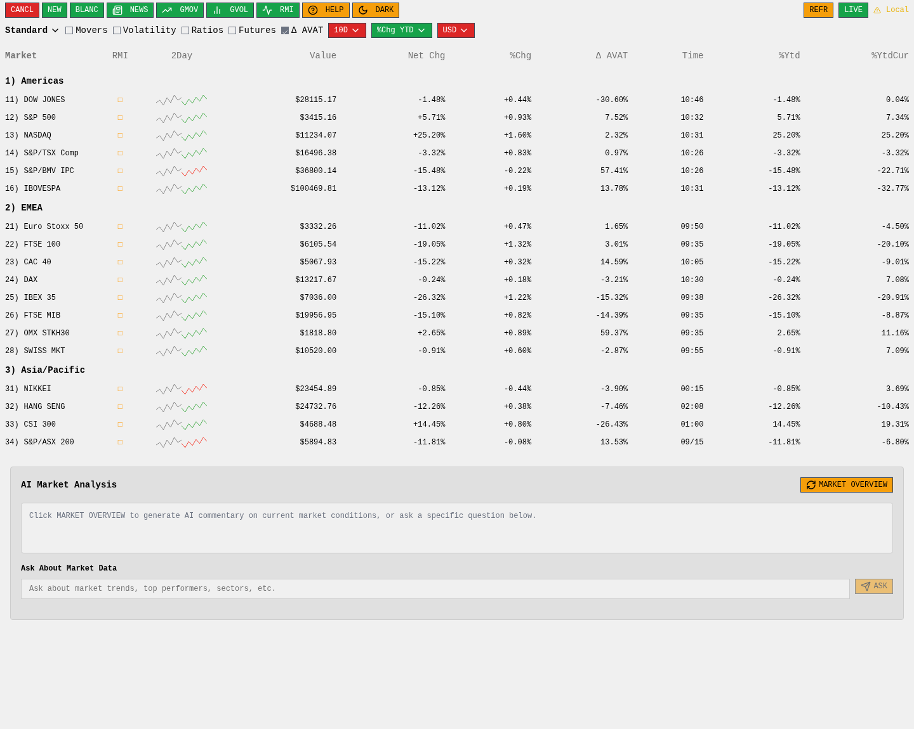

# Aurum

C++ and Python paper-trading research, with a Next.js terminal.

The working path is a moving-average crossover backtest: C++ generates signals and checks long-only position limits; Python loads bars, applies next-bar fills, fees and slippage, and computes equity and drawdown. The existing frontend calls the Python market-data API. Its pages, components, layout and styling are unchanged; the backtest is available through the API.

**Research only. No broker execution, real-money orders, live mutual-fund trading, or claims of profitable performance. The default datasets are synthetic/sample data, identified in API provenance and this README. The terminal retains its original appearance.**



## Run locally

Verified on Linux with Python 3.10, Node 22, pnpm 9.15, CMake and a C++17 compiler. Python development headers are required. CMake downloads versioned spdlog, nlohmann/json and GoogleTest sources on the first build.

```bash
# From the repository root
python3 -m venv .venv
source .venv/bin/activate
python -m pip install -e './backend[test]'
cmake -S backend/backend -B backend/backend/build \
  -DPython3_EXECUTABLE="$PWD/.venv/bin/python"
cmake --build backend/backend/build -j2

# Terminal 1, with the same virtual environment active
python backend/run_web_interface.py

# Terminal 2
cd frontend
pnpm install --frozen-lockfile --ignore-scripts
pnpm dev
```

Open the existing terminal at `http://localhost:3000/`. Run backtests through the API example below or the interactive API documentation at `http://127.0.0.1:8000/docs`; `/api/health` reports whether the native core loaded.

No API keys, Redis or database are required for this demo. `AURUM_BACKEND_URL` can override the frontend's server-side backend URL, default `http://127.0.0.1:8000`. Never put private keys in `NEXT_PUBLIC_*` variables.

## What works in this path

- The original terminal sample dataset is served by Python without changing the screen. The terminal prices are not live quotes.
- A separate deterministic synthetic OHLCV fixture for 2025 supports offline backtest requests after installation.
- C++ per-symbol crossover state with duplicate-bar rejection and bounded price history.
- C++ fail-closed checks for invalid prices/quantities, cash, position limits and unheld sells.
- Python accounting for long-only, one-asset paper backtests. Signals at a bar's close fill at the next bar's open, with explicit fees and adverse slippage.
- A Python Yahoo Finance historical-data option through the API. It requires internet access and returns a provider error rather than silently substituting synthetic prices.
- The existing market terminal connected to Python through its API route, without page, component, layout or style edits. Equity, fill ledger and assumptions are returned by the backtest API.

The older factor/AI HTTP endpoints now return `501` instead of invented results. The old Redis seeding/simulation scheduler routes return `410`. Optional legacy AI, ML, Streamlit and experimental trading projects remain in the repository, but are not part of the verified path.

## Test

```bash
# With the virtual environment active and frontend dependencies installed
PYTHON=python bash scripts/check.sh
```

At the local verification checkpoint: **38 Python tests passed, 1 skipped; 8 C++ tests passed; TypeScript check and Next.js production build passed.** The skipped test is a live API integration test; this is not a claim that every experiment in the monorepo has been tested. See [verification](docs/VERIFICATION.md).

The original and wired terminal were compared using identical sample data at 1440x1150. Their screenshots had no differing pixels: [before](docs/images/terminal-before.png), [after](docs/images/terminal-after.png). This is a controlled UI comparison, not a claim that sampled prices are current.

## API example

```bash
curl -s http://127.0.0.1:8000/api/backtest/run \
  -H 'Content-Type: application/json' \
  -d '{"source":"demo","strategy_config":{"strategy_name":"ma_crossover","symbols":["DEMO"],"parameters":{"short_window":10,"long_window":30,"max_weight":0.1}}}'
```

For historical Yahoo data, set `source` to `yahoo`, choose a supported ticker, and supply `start_date` and `end_date` inside `strategy_config`. The provider's end date is exclusive. Prices are adjusted by the provider; availability and data quality are not guaranteed. Default dates remain in 2025, not the current trading session.

## Documentation

- [Master document: architecture, scope, inventory and roadmap](docs/MASTER.md)
- [Verification and known limitations](docs/VERIFICATION.md)
- [Reference and video notes](docs/REFERENCES.md)

## Origins and scope

Original references: [feremabraz/bloomberg-terminal](https://github.com/feremabraz/bloomberg-terminal) and [0xemmkty/QuantMuse](https://github.com/0xemmkty/QuantMuse). The `tradingalgo/` directory contains separate learning projects and third-party-derived material. Their presence is not a claim that they are integrated or authored entirely here. No new repository-wide license is asserted by these changes; review each component's provenance and permissions before redistribution.
